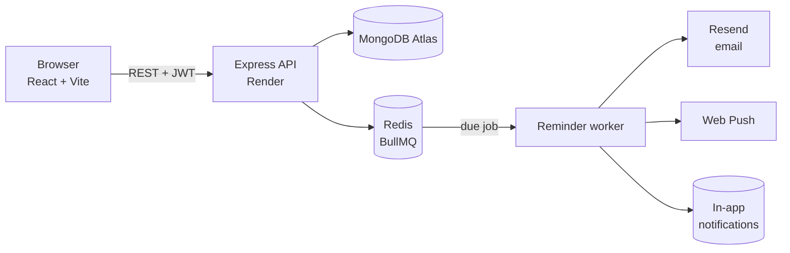

<div align="center">


# TaskFlow

### Plan Your Day. Focus on What Matters. Achieve More.

A full-stack smart daily productivity platform — tasks, rich notes, Pomodoro focus, calendar, goals, analytics and **real server-side email reminders**.

[](https://taskflow-web-xyub.onrender.com)
[](https://taskflow-api-t19t.onrender.com/api/health)


</div>

---

## 🌐 Live demo

| | URL |
|---|---|
| **Web app** | https://taskflow-web-xyub.onrender.com |
| **API** | https://taskflow-api-t19t.onrender.com |
| **Health check** | https://taskflow-api-t19t.onrender.com/api/health |

> Hosted on Render's free tier — the API sleeps after 15 minutes idle, so the **first request can take ~50 seconds** to wake it up.

<!-- SCREENSHOTS -->

## ✨ Features

<table>
<tr>
<td width="50%" valign="top">

### 📋 Tasks
- Full CRUD with **Low / Medium / High / Urgent** priorities
- Due dates, tags, estimates, status
- **Recurring tasks** — daily, weekdays, weekly, monthly
- Search, filter by status/priority/tag, sort

### 📝 Smart notes
- Rich text: bold, italic, underline, strike, headings, lists, quotes
- **Highlighting**, color labels, pinning
- Autosave · sanitized with DOMPurify

### ⏱️ Focus & time tracking
- Pomodoro with configurable focus / short / long breaks
- Stopwatch + manual entries
- Sessions logged per task

</td>
<td width="50%" valign="top">

### 🔔 Reminders & notifications
- Custom date/time, per-channel email · push · in-app
- **Resend** email to the user's registered address
- BullMQ + Redis scheduling, cancel, snooze
- Duplicate prevention & honest delivery status
- In-app notification center + Web Push

### 📅 Calendar · 🎯 Goals · 📊 Analytics
- Day / week / month views
- Daily & weekly goals that track themselves
- Charts computed from real activity

### 🎨 Experience
- Light / dark / system themes
- Responsive with a mobile bottom nav
- JWT auth, per-user data isolation

</td>
</tr>
</table>

## 🏗️ Architecture



### How reminders work

1. `POST /api/reminders` saves the reminder with a unique `(user, dedupeKey)` index — the same task at the same minute returns `409`.
2. A BullMQ delayed job is queued with `jobId = reminderId` (no duplicate jobs). Without Redis, a MongoDB poller runs every 30s.
3. At fire time the reminder is atomically claimed (`scheduled → processing`), so it can never be sent twice.
4. The recipient is **always the authenticated user's registered email** — never taken from the request.
5. Status is recorded honestly: `sent` only when Resend returns a message id; otherwise `failed` (with the error) or `not_configured`.

## 🚀 Deployment (Render)

| Service | Type | Root | Build | Start |
|---|---|---|---|---|
| `taskflow-api` | Web Service (Node 22) | repo root | `cd server && npm install --include=dev && npm run build` | `cd server && npm start` |
| `taskflow-web` | Static Site | repo root | `cd client && npm install --include=dev && npm run build` | publish `client/dist` |
| `taskflow-redis` | Key Value | — | — | — |

### Environment variables

**`taskflow-api`**

| Variable | Required | Notes |
|---|:---:|---|
| `MONGODB_URI` | ✅ | MongoDB Atlas connection string |
| `JWT_SECRET` | ✅ | Long random string |
| `RESEND_API_KEY` | 📧 | Resend key with *Sending access* |
| `EMAIL_FROM` | 📧 | Sender on a verified Resend domain (e.g. `TaskFlow <reminders@yourdomain.com>`) |
| `CLIENT_ORIGIN` | ✅ | Frontend URL (CORS) |
| `REDIS_URL` | ⚙️ | Enables BullMQ; falls back to the MongoDB poller |
| `VAPID_PUBLIC_KEY` / `VAPID_PRIVATE_KEY` / `VAPID_SUBJECT` | ⚙️ | Web Push |

**`taskflow-web`** — `VITE_API_URL` = API origin.

> 🔒 Secrets live only in Render's environment settings — never in the repo or the frontend bundle.

## 💻 Run locally (Windows PowerShell)

```powershell
git clone https://github.com/nvaltryek-001/TASKFLOW-.git
cd TASKFLOW-

# API
cd server
npm install
Copy-Item .env.example .env   # then fill in MONGODB_URI, JWT_SECRET, RESEND_API_KEY, EMAIL_FROM
npm run dev                   # http://localhost:4000

# Web (new window)
cd TASKFLOW-\client
npm install
npm run dev                   # http://localhost:5173
```

```powershell
cd server; npm test           # API tests (mongodb-memory-server)
cd ..\client; npm run typecheck; npm run build
```

## 📡 API

All routes except register, login and health need `Authorization: Bearer <token>`.

| Method | Endpoint | Purpose |
|---|---|---|
| `POST` | `/api/auth/register` · `/api/auth/login` | Auth |
| `GET` `PATCH` | `/api/auth/me` · `/api/auth/settings` | Profile & preferences |
| `GET` | `/api/auth/integrations` | Which integrations are configured |
| `GET` `POST` `PATCH` `DELETE` | `/api/tasks[/:id]` | Tasks (`?search&status&priority&tag&from&to&sort`) |
| `GET` `POST` `PATCH` `DELETE` | `/api/notes[/:id]` | Notes |
| `GET` `POST` | `/api/reminders` | List / schedule reminders |
| `POST` | `/api/reminders/:id/cancel` · `/snooze` | Cancel / snooze |
| `GET` `POST` | `/api/notifications` · `/read-all` | Notification history |
| `GET` `POST` `DELETE` | `/api/time` | Time entries |
| `GET` `POST` `PATCH` `DELETE` | `/api/goals` | Goals |
| `GET` | `/api/analytics?days=14` | Analytics |
| `GET` | `/api/health` | DB / email / scheduler status |

## 📁 Project structure

```
TASKFLOW-/
├── client/                 React + Vite frontend
│   ├── public/             icon, service worker (Web Push)
│   └── src/
│       ├── components/     Layout, TaskForm, TaskItem, UI kit
│       ├── pages/          Dashboard, Tasks, Calendar, Focus, Notes, Goals, Analytics, Reminders, Settings
│       ├── store/          Zustand stores (auth, tasks, UI)
│       └── lib/            API client, notifications
└── server/                 Express + TypeScript API
    ├── src/
    │   ├── models/         Mongoose schemas
    │   ├── routes/         auth, tasks, notes, reminders, productivity
    │   ├── services/       email (Resend), push, reminders (BullMQ), recurrence
    │   └── middleware/     JWT auth
    └── test/               Vitest + Supertest
```

<div align="center">

Made with 💜 · ** TaskFlow ** — Plan Your Day. Focus on What Matters. Achieve More.

</div>
